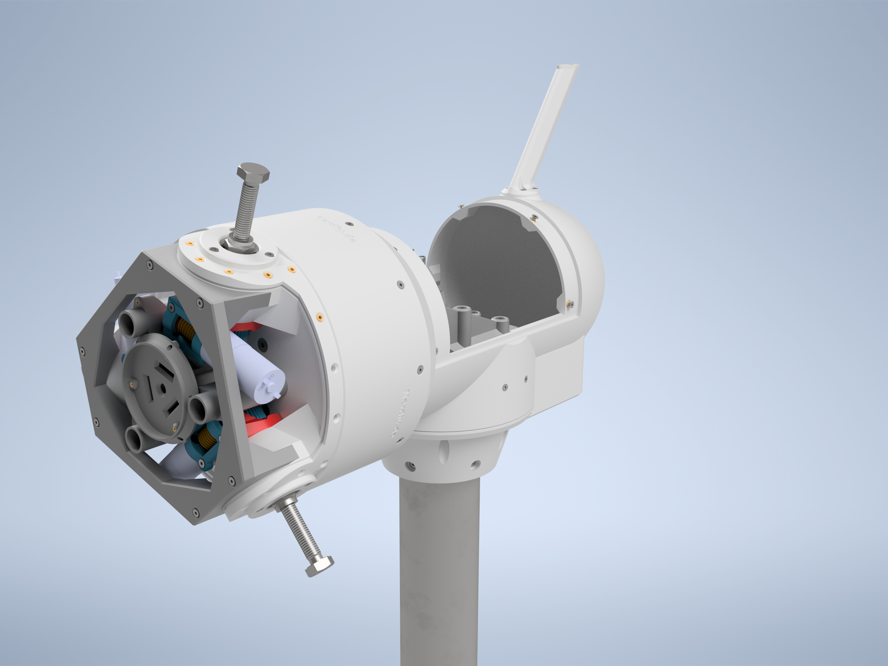
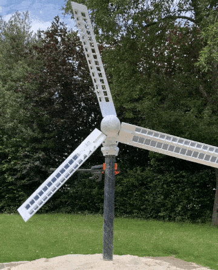
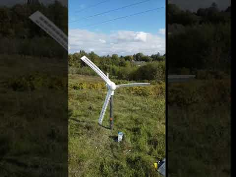
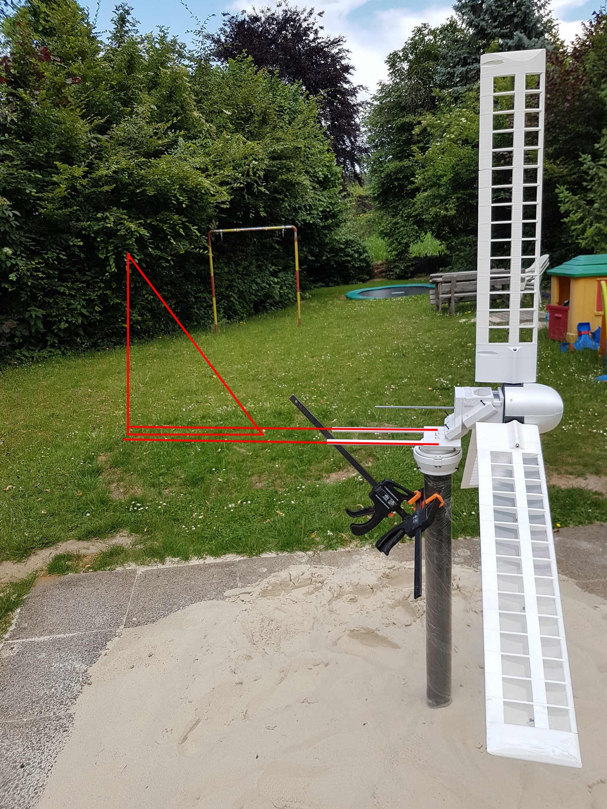
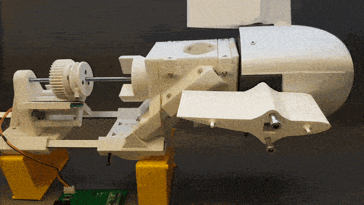
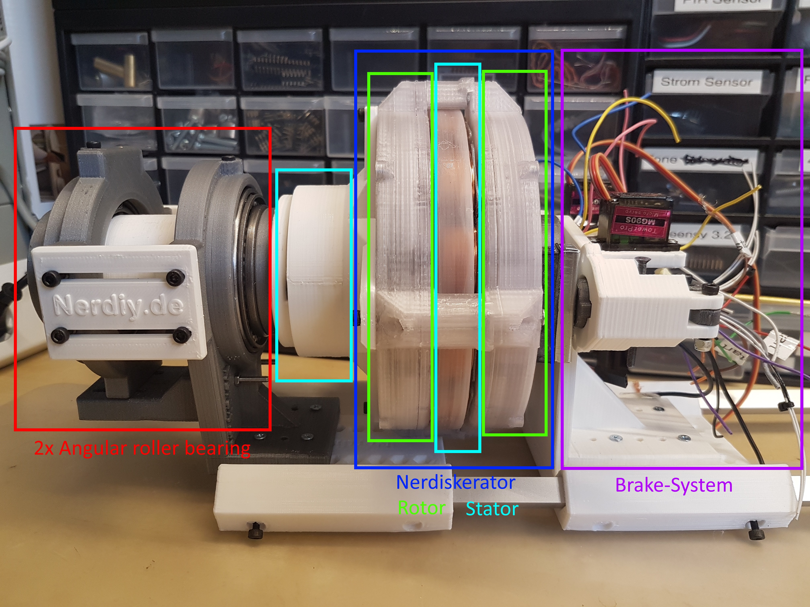
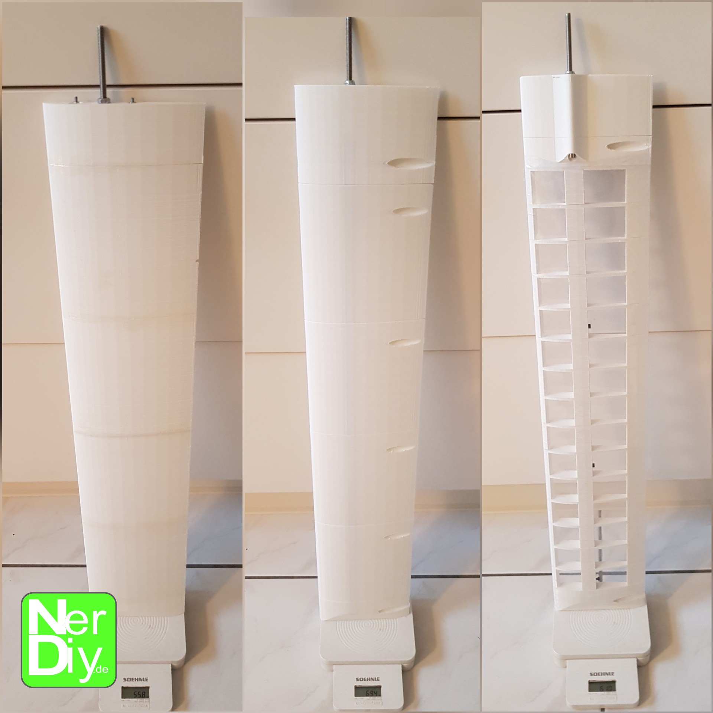

# WinDIY - HAWT Wind turbine | Details

***UPDATE:***

***i started the development and build of a new version of WinDIY.
I will post more information in a new project log and on my Instagram.***

***You can find more infos here:***

- ***<https://www.instagram.com/nerdiy.de/>***
- [***https://hackaday.io/project/184849-windiy2-horizontal-axis-wind-turbine***](https://hackaday.io/project/184849-windiy2-horizontal-axis-wind-turbine)
- ***<https://nerdiy.de/en/news-mai-2021-aktuelle-projekte-und-entwicklungen/>***

***I hope to see you there :)***

Latest design state of the new version "WinDIY\_2"

---

**Brief overview of what this is about:**

- Wind turbine build from 3D printed parts
- HAWT design
- Rotor diameters from 0.5 to 1.2m possible
- 3D printed wings
- Uses a 3D printed disk generator for energy generation
- Safety functions through active pitch adjustment of the wings, mechanical brake and electronic brake function via the disk generator
- Can be printed using any "normal" (20x20cm bed size) FDM Printer

**WinDIY on its first test run:**

**Side view:**

(Wind vane will be added soon)

**WinDIYs pitch actuator:**

More infos: <https://hackaday.io/project/172328/log/180247-the-pitch-actuator-in-action> and here <https://hackaday.io/project/172328/log/179105-windiys-hub-oh-my-god-mechanics>

**ToDo:**

- Test the heat sink bracket for the load resistors: *pending*
- Design controller circuit: *pending*
- Create assembly instructions for hub: *pending*
- Create assembly instructions for wing: *pending*
- Create assembly instructions for the wind vane: *pending*
- Create assembly instructions for turret: *pending*
- Create assembly instructions for main axis: *pending*
- Design adapters for other standpipe diameters and also square bars (including clamping jaws): pending

**Finished features:**

- Design adapter for driving the main axis via a DC motor: **done:** **<https://hackaday.io/project/172445/log/180101-test-stand-for-the-nerdiskerator>**
- Design and print mount for pitch-actuator: **done: <https://hackaday.io/project/172328/log/180247-the-pitch-actuator-in-action>**
- Design and print the main axis housing: **done**:
- Mount the wind vane: **designed and printed, not assembled yet**
- Design Hub mechanics that allow plade-pitch adjustment: **done:** <https://hackaday.io/project/172328/log/179105-windiys-hub-oh-my-god-mechanics>

**1. Why (in general):**

I actually started this project as a follow-up project from the Nerdiskerator (infos here: <https://hackaday.io/project/172445-nerdiskerator-a-3d-printed-disk-generator>). This is a disk generator that I initially built as a kind of experiment. When I had successfully built it up I thought "Just putting it on the shelf is a shame". (I like to build things that have a practical use even after they have been set up.) So the Nerdiskerator should also get a practical use and maybe even relieve my electricity bill a bit. :)

Since I have no flowing water in the area, a water turbine is unfortunately not an option to drive the generator. Fortunately there is wind here where I live. Not much, but certainly enough to be able to harvest some free watts from Mother Earth here and there.

When researching for available and easy replicable wind turbine designs, I noticed that there is a lot of scattered information about building a wind generator yourself. Unfortunately, many of them were old and none of them seemed to me to be easy to replicate. I was hoping somehow that someone out there had already developed a design for a wind turbine that could easily be "reprinted" with a 3D printer.

I found a couple of designs, but either they weren't suitable or consisted of parts that could only be printed with very large 3D printers. Unfortunately, there was not a 3D printable design for a HAWT wind turbine as I imagined. I was looking for something easy scalable, easy adaptable and of course it should be safe.

Since I couldn't find something like this I decided to develop an own design of an easy replicable HAWT wind turbine. :)

**2. Why a HAWT-Design:**

*First, because of the many technical arguments:*

HAWT wind turbines are more efficient because all blades work in the wind at the same time. In addition, none of the wings prevent the effect of the wind like it happens with a VAWT-design wind turbine.

*Second, as a personal challenge:*

I like the various technical problems that have to be solved here. Additionally, at least until now there are not many DIY HAWT designs for wind turbines available.

**3. Why build yourself when you could simply buy it?**

Of course you could also buy such a wind turbine. Probably even cheaper and maybe more powerful than WinDIY. So why build yourself?

*First:* I think, especially in connection with the challenges of climate change, increasing energy consumption and in general the increasing interdependency of technology and everyday human life, it is important to become aware of how something works and how our technology not only affects our lives but also how we are influencing technology.

I think it is important not just to "consume" technology. We should also have interest and curiosity to constantly question the existing technology and look for potential for improvement. But this only works if you understand existing technologies. When you buy a technological product, you usually only see the end product. You cannot see which technological problems have been solved on the way there. Many technical details that seem unimportant at first glance remain mostly hidden. I believe "building it yourself" is the best way to understand technologies, physical relationships and their best use.

For me personally, WinDIY is a good example of this. Without WinDIY, I probably would not have dealt with the basic functions of a wind turbine. I would never have thought about how to design a wing as lightweight as possible. And I certainly would not have thought about the demands that must be made of the materials of a generator so that it does not melt into a chunk of PLA under load or higher temperatures.

*Second:* With "WinDIY" I would like to show you what can be built with a 3D printer and a few mechanical standard parts.

Especially during the corona pandemic it became obvious that we (in the "developed" countries) have a special luxury good: almost no matter what part, device or product we want. Once ordered, it will be in our mailbox within a few days.

It's easy to forget that this type of logistics is not available everywhere and also shouldn't be taken for granted by "us".

During the corona pandemic, you could already see that 3D printers can be very helpful in these situations. When personal protective equipment became rare almost everywhere, 3D printers ran in almost every makerLab 24/7 to manufacture face shields and other useful equipment.

Of course "WinDIY" cannot protect against viruses. But it can deliver energy, which then enables light, heat or communication. These in turn are important building blocks to save lives and enable survival. Above all, it is an example of "what is possible".

**Additional thoughts on the modularity of WinDIY**

I want to keep WinDIY modular. Not only because individual parts can be repaired or replaced quickly and easily. WinDIY can also be scaled in this way (to a certain extent, of course).

For example, the wings of WinDIY are designed the way that their wingspan can be varied easily. In case there is not enough space or there is not that much energy required, the wing can simply be assembled with just ten or five of the initially planned 15 rafters.

In this case, of course, the WinDIY boom and the wind vane should also be a bit smaller. This is not a problem, because in this case the connecting aluminum profiles are simply cut and installed a little shorter.

Something similar applies to the generator. I am currently working on the "Nerdiskerator Mark1" (<https://hackaday.io/project/172445-nerdiskerator-a-3d-printed-disk-generator>) and will use it with WinDIY to generate energy. However, this is only mechanically linked to WinDIY via the main shaft. It could easily be exchanged for another more/less powerfull or different generator. Even a pump would be possible.

For example, I could also imagine, that the rotary motion of WinDIY could be transferred to a peristaltic pump via a gear. This means that a well pump for irrigating a field can be set up with relatively few mechanical parts and completely without electronics.

I believe that with this modular design, every part of WinDIY can be optimized for the respective application on site. Regardless of whether it is a remote radio relay station, a tent in the wild or your own home far from a fixed electricity or water supply.

You can find more thoughts about what motivates me here: <https://nerdiy.de/en/category/in-eigener-sache/ueber/>

---

**Main shaft incl. 3D printed disk generator and mechanical brake system:**

More infos here: <https://hackaday.io/project/172328/log/179187-some-words-about-safety-the-mechanical-brake-system>

---

**Evolution of the wing-design:**

More infos here: <https://hackaday.io/project/172328/log/179141-windy-wing-mark-3-a-modular-easy-replaceable-and-scalable-blade>

---

**Support:**

If you want to support me, you can do so by like on this project page, on [Instagram](https://www.instagram.com/nerdiy.de/) or by donating a . :)

---

**Licenses:**

*Content that is not based on software/code:*  
Unless otherwise stated, all works presented here that are not based on software/code are subject to the CC BY-NC-SA 4.0 license (attribution – non-commercial – dissemination under the same conditions 4.0 international).

You can find a summary here: <https://creativecommons.org/licenses/by-nc-sa/4.0/deed.de>

You can find the complete legal text here: <https://creativecommons.org/licenses/by-nc-sa/4.0/legalcode.de>

*Software/code-based works*Unless otherwise stated, all software/code-based works presented here are subject to the GNU Affero General Public License v3.0

You can find a summary here: <https://tldrlegal.com/license/gnu-affero-general-public-license-v3-(agpl-3.0)#summary>

The complete legal text can be found here: <https://www.gnu.org/licenses/agpl-3.0.de.html>
